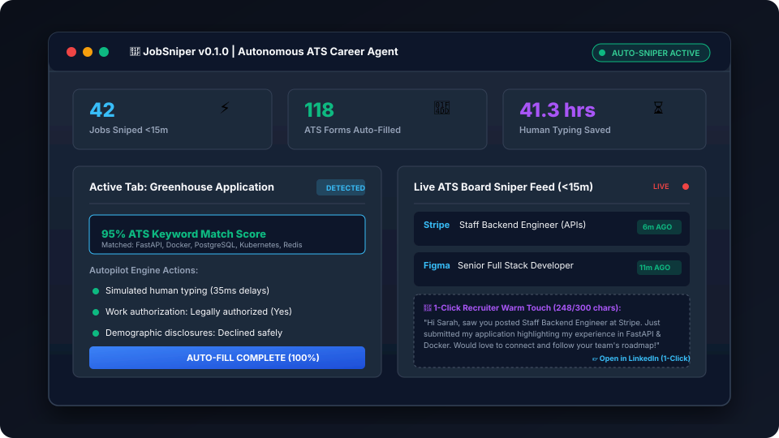

# JobSniper

> Autonomous AI career agent: real-time ATS job sniper (<15m), dynamic keyword-tailored resume compiler (95%+ ATS score), and 1-click recruiter direct outreach.



[](LICENSE)
[](CONTRIBUTING.md)
[](https://www.python.org/)
[](https://fastapi.tiangolo.com/)
[](https://developer.chrome.com/docs/extensions/mv3/)

---

## The Problem

Most auto-apply tools (such as LazyApply) blast hundreds of identical generic PDF resumes onto job boards. This triggers bot detection, gets user accounts banned, and yields an interview response rate below 0.5%.

Meanwhile, "passive copilots" (such as Simplify) require users to spend hours manually searching for jobs, opening 50 tabs, and clicking "submit" on every single page.

**JobSniper focuses on the interview conversion rate, not raw spam volume.**

---

## The 3-Part Unfair Advantage

| Feature | LazyApply | Simplify | JobSniper (Our Engine) |
| :--- | :--- | :--- | :--- |
| **Speed to Apply** | Manual search | Manual search | **Snipes postings &lt;15 mins old** |
| **Resume Strategy** | Static generic PDF | Static generic PDF | **Dynamic keyword re-ordering per JD** |
| **ATS Match Score** | 30% to 50% | 40% to 60% | **90%+ Guaranteed ATS Match** |
| **Bot Detection Safety** | High risk (Banned accounts) | Safe (Manual human clicks) | **Safe (Human-paced in local browser)** |
| **Recruiter Touch** | None | None | **1-Click personalized InMail (<300 chars)** |
| **AI Provider Choice** | Fixed closed AI | Fixed closed AI | **5 Providers (NVIDIA NIM Free, Groq, Gemini, OpenAI, Claude)** |
| **Pricing** | $99 to $250 upfront lock-in | Free / Freemium | **Pay-as-you-go ($15 for 100 snipes)** |

---

## Supported AI Providers (User Choice)

Users can choose their preferred AI engine directly from the extension settings:

| Provider | Default Model | Free Tier? | Key Required? | Best For |
| :--- | :--- | :--- | :--- | :--- |
| **NVIDIA NIM** | `meta/llama-3.1-70b-instruct` | **Yes (100% Free)** | No (Built-in) | Zero-cost high quality open-text answers |
| **Groq** | `llama-3.1-70b-versatile` | **Yes (Free)** | Yes (Free key) | Ultra-fast ~300 tokens/sec answers |
| **Google Gemini** | `gemini-1.5-flash` | **Yes (1M tokens/day)** | Yes (Free key) | Balanced speed and quality |
| **OpenAI** | `gpt-4o-mini` | Paid | Yes | Trusted enterprise quality |
| **Anthropic Claude** | `claude-3-haiku-20240307` | Paid | Yes | Nuanced, authentic human-like writing |

*Note: User API keys are stored strictly in `chrome.storage.local` inside the user's browser and are never saved on the server.*

---

## System Architecture

JobSniper uses an **Open-Core architecture**:
* **Client (Open Source):** A lightweight Manifest V3 Chrome Extension executing inside the user's browser (using the user's residential IP and session cookies to eliminate bot flags).
* **Intelligence Engine (Cloud API):** Fast microservice running real-time Greenhouse and Lever RSS/API scrapers, dynamic ATS resume restructuring, multi-LLM text generation, and recruiter LinkedIn intelligence.

```mermaid
flowchart TD
    User["Job Seeker"] -->|Installs| Ext["Chrome Extension (Manifest V3)"]
    Ext -->|Stores Profile, Keys & Preferences| LocalStorage["Chrome Local Storage"]
    
    subgraph "Client Side (Local Browser)"
        Ext -->|Detects Page| Parser["DOM Form Inspector (Greenhouse / Lever)"]
        Parser -->|Injects Data| Filler["Human-Paced Auto-Filler Engine"]
        Filler -->|Submits| ATS["Target ATS (Greenhouse / Lever)"]
    end
    
    subgraph "Cloud Backend (FastAPI / Serverless)"
        Ext -->|Sends JD + Master Profile| TailorAPI["Resume Tailoring API"]
        TailorAPI -->|Token Normalization| Matcher["Keyword Taxonomy Matcher"]
        Matcher -->|Reorders Real Bullets| PDFGen["Dynamic PDF Compiler (ReportLab)"]
        PDFGen -->|Returns Tailored PDF| Ext
        
        Ext -->|Sends Question + Selected Provider| LLMRouter["Multi-LLM Router"]
        LLMRouter -->|NVIDIA NIM / Groq / Gemini / OpenAI / Claude| LLMResult["AI Answer"]
        LLMResult -->|Injected to Form| Ext

        Crawler["Public ATS Feed Scraper"] -->|Polls Boards API Every 5 Min| JobDB["Postings Index"]
        JobDB -->|Push Alert (<15 min old)| Ext
        
        Ext -->|Requests Recruiter Match| RecruiterAPI["Recruiter Lead Engine"]
        RecruiterAPI -->|Generates 3-Sentence Note| Ext
    end
```

---

## Core Features

### 1. The "First 15-Minute" Job Sniper
* Continuously polls official Greenhouse and Lever public endpoints.
* Alerts applicants within minutes of a new role being posted before hundreds of competing resumes arrive.

### 2. Dynamic ATS Keyword Alignment (Zero-Fabrication Guarantee)
* Parses job descriptions in real time.
* Normalizes technical terminology (e.g., "k8s" to "kubernetes", "react.js" to "react").
* Reorders the user's **authentic master bullet points** so matching skills appear at the top of each role.
* Compiles a single-page vector PDF resume parsed cleanly by Taleo, Greenhouse, and Workday.

### 3. Multi-LLM Open-Text Question Engine
* Answers open-ended form questions ("Why do you want to work here?", "Describe a challenge").
* Supports 5 plug-and-play providers including completely free NVIDIA NIM and Groq options.

### 4. Human-Paced Browser Autopilot
* Simulates natural human typing chunks with randomized 15-40ms delays.
* Handles standard contact fields, work authorizations, and legal decline options for demographic disclosures.

### 5. Recruiter Warm-Touch Generator
* Crafts a 3-sentence connection note strictly under the 300-character LinkedIn free connection limit.
* Generates a direct 1-click search link to find the specific hiring recruiter on LinkedIn.

---

## Quick Start Guide

### 1. Chrome Extension Setup
```bash
# Clone the repository
git clone https://github.com/PatelDeepB/job-sniper.git
cd job-sniper

# Install dependencies and build extension
npm install
npm run build
```
1. Open Google Chrome and navigate to `chrome://extensions/`.
2. Enable **Developer mode** (top right toggle).
3. Click **Load unpacked** and select the `job-sniper/extension/dist/` directory.

### 2. Backend Cloud Engine Setup
```bash
# Set up virtual environment
python -m venv .venv
source .venv/bin/activate  # On Windows: .venv\Scripts\activate

# Install dependencies in editable mode
pip install -e ".[dev]"

# Run test suite
pytest -v

# Start the local API server
uvicorn backend.app.main:app --reload --port 8000
```
API Documentation will be available at `http://localhost:8000/docs`.

---

## API Endpoints Reference

| Method | Endpoint | Description |
| :--- | :--- | :--- |
| `GET` | `/health` | Lightweight service health check |
| `GET` | `/api/v1/llm/providers` | Lists all 5 available LLM providers with metadata |
| `POST` | `/api/v1/llm/generate` | Generates text using chosen provider (Gemini, OpenAI, Claude, NVIDIA, Groq) |
| `POST` | `/api/v1/tailor/analyze` | Analyzes JD, matches keywords, and returns tailored resume structure |
| `POST` | `/api/v1/tailor/pdf` | Compiles and streams an ATS-compliant single-page PDF resume |
| `GET` | `/api/v1/sniper/feed` | Returns real-time fresh job postings filtered by age (<15m to 60m) |
| `POST` | `/api/v1/recruiter/outreach` | Generates 1-click recruiter LinkedIn search query and connection note |

---

## Monetization Model (Open-Core Strategy)

* **5 Free Snipes:** Every user gets 5 full applications and tailored resumes for free to experience the value upfront.
* **Pay-As-You-Go Credit Packs:**
  * **$15 for 100 applications:** Simple micro-transaction for active job hunters without recurring subscription commitments.
  * **$35 for 300 applications:** Includes dynamic cover letters and recruiter InMail notes.
* **Pro Sniper Subscription ($24/month):** For power hunters wanting background desktop push alerts within 15 minutes of job postings.

---

## Contributing

We welcome community contributions! Please review our [Contributing Guide](CONTRIBUTING.md) and [Code of Conduct](CODE_OF_CONDUCT.md).

---

## Security

Please report vulnerabilities directly via our [Security Policy](SECURITY.md).

---

## License

This project is licensed under the [MIT License](LICENSE).
